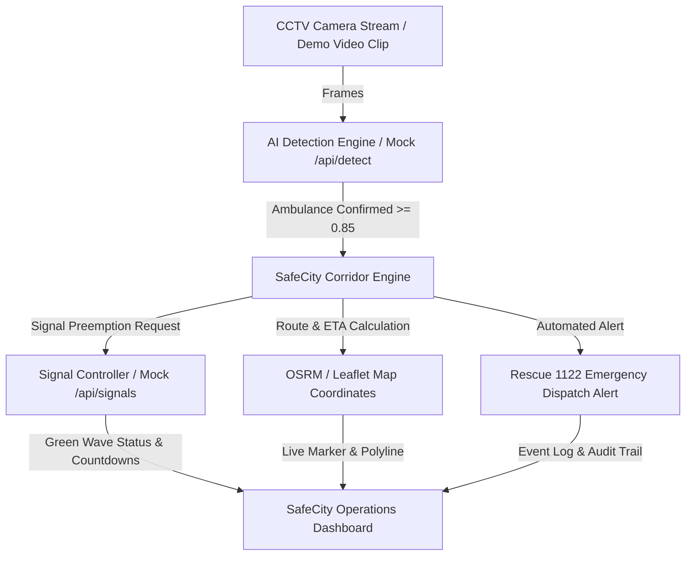

# SafeCity AI — Ambulance Green Corridor

[](https://opensource.org/licenses/MIT)
[](https://nextjs.org/)
[](https://tailwindcss.com/)
[](https://www.typescriptlang.org/)
[]()

> **Intelligent Emergency Preemption Dashboard for Abbottabad, Pakistan.**  
> CCTV-based computer vision detects approaching emergency vehicles, computes optimal paths to City Hospital, and dynamically pre-empts traffic signals to green ahead of the ambulance—saving critical golden-hour minutes.

---

> **SIMULATION NOTICE:** SafeCity AI is a simulation dashboard created for educational and hackathon demonstration purposes. It models emergency vehicle preemption (EVP) logic and **does not control or manipulate physical traffic signal hardware**.

---

## Live Demo & Preview
- **Production URL:** [https://safecity-ai.vercel.app](https://safecity-ai.vercel.app) *(TBD upon deployment)*
- **Demo Prototype:** Open [prototype/safecity-frontend.html](file:///c:/Users/ATECH/Desktop/Hachathon/prototype/safecity-frontend.html) directly in any web browser.

### Preview Screenshots
| Live Detection & CCTV Feed | Green Corridor & Signal Map |
|:---:|:---:|
|  |  |

---

## Demo-Critical Feature & Differentiator
- **Demo-Critical Flow:** When an ambulance appears in camera `CCTV-01` (Main Boulevard), AI detection triggers an immediate route calculation to City Hospital, dynamically pre-empting all 4 downstream traffic intersections to Green.
- **The Differentiator:** A real-time synchronized map showing the ambulance marker navigating along Main Boulevard, signal countdown timers switching ahead of the vehicle, instant dispatch alert dispatched to Rescue 1122, and live calculation of "ETA with vs. without corridor" (highlighting minutes saved).

---

## Architecture Overview



---

## Tech Stack

| Layer | Technology | Purpose |
|---|---|---|
| **Frontend Framework** | Next.js 14 (App Router) + TypeScript | Responsive, accessible emergency operations dashboard |
| **Styling & System** | Tailwind CSS + Solid Design Tokens | Precision high-contrast UI (No gradients, WCAG AA compliant) |
| **Mapping & GIS** | Leaflet + OpenStreetMap | Interactive corridor tracking & intersection markers |
| **Icons** | Lucide React | Consistent, lightweight vector iconography (No emojis) |
| **State & Data Fetching** | React Hook Form, Zod, SWR / React State | Predictable contract parsing and mock-first state |
| **Backend & Storage** | Next.js Server Actions / Supabase (Optional) | Signal state orchestration and historical event logging |
| **Deployment** | Vercel | Instant global edge preview and production hosting |

---

## Quick Start Guide

### 1. Prerequisites
- Node.js 18.17+ or 20+
- npm or pnpm

### 2. Installation
```bash
git clone https://github.com/safecity-ai/safecity-green-corridor.git
cd safecity-green-corridor
npm install
```

### 3. Environment Configuration
Copy the template environment file:
```bash
cp .env.example .env.local
```
*(All frontend features run with 100% functional mock-first fallbacks if backend env vars are empty).*

### 4. Running Locally
```bash
npm run dev
```
Open [http://localhost:3000](http://localhost:3000) in your browser.

---

## Project Repository Structure
```
├── /app                  # Next.js App Router (Dashboard pages & API routes)
├── /brain                # Complete Project Brain (PRD, Architecture, Decisions, etc.)
│   ├── 00-START-HERE.md  # Reading roadmap & phase tracking
│   ├── changes/          # Changelog, current-state, and session logs
│   └── prompts/          # AI prompt templates for auditing and features
├── /components           # Reusable atomic UI components (Tokens compliant)
├── /prototype            # Standalone single-file HTML prototype reference
├── /public               # Static assets, camera test clips, map markers
└── CLAUDE.md             # AI Agent master operational entrypoint
```

---

## Team SafeCity AI

| Member | Role | Primary Ownership |
|---|---|---|
| **Abdul Wahid** | Lead Frontend Engineer | Responsive UI, Design Tokens, Map & Dashboard Components (`/app`, `/components`, `/styles`) |
| **Zeeshan Maqsood** | Backend & DevOps Lead | Data Contracts, Signal Orchestration API, Supabase, Vercel Deployments (`/app/api`, `/lib`, `/supabase`, `/ml`) |
| **Malik Faseeh Awan** | Product & Demo Lead | Project Brain, Demo Video, Pitch Deck, Testing Checklist, Submission Package (`/brain`, `/demo`, `/docs`) |

---

## License
This project is open-source software licensed under the [MIT License](file:///c:/Users/ATECH/Desktop/Hachathon/LICENSE).
